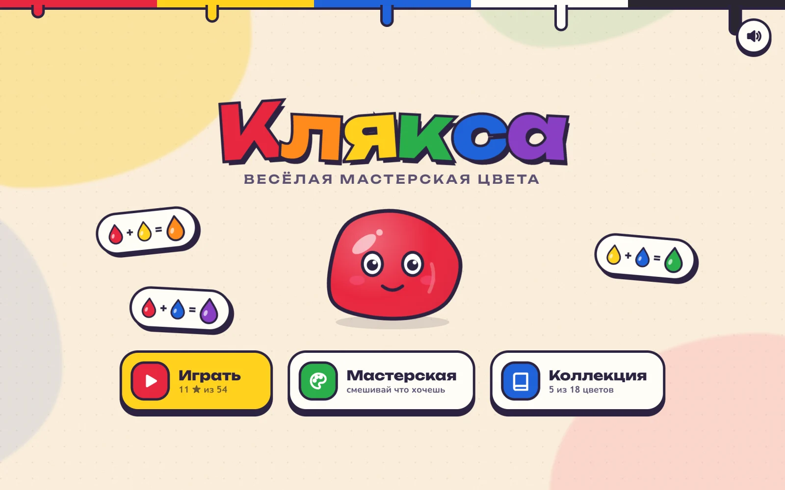
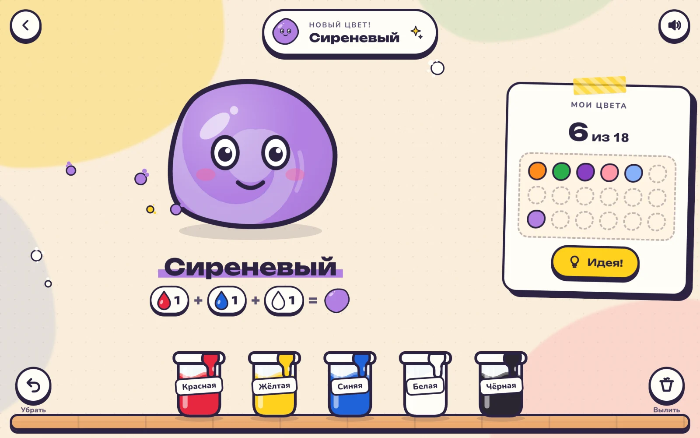
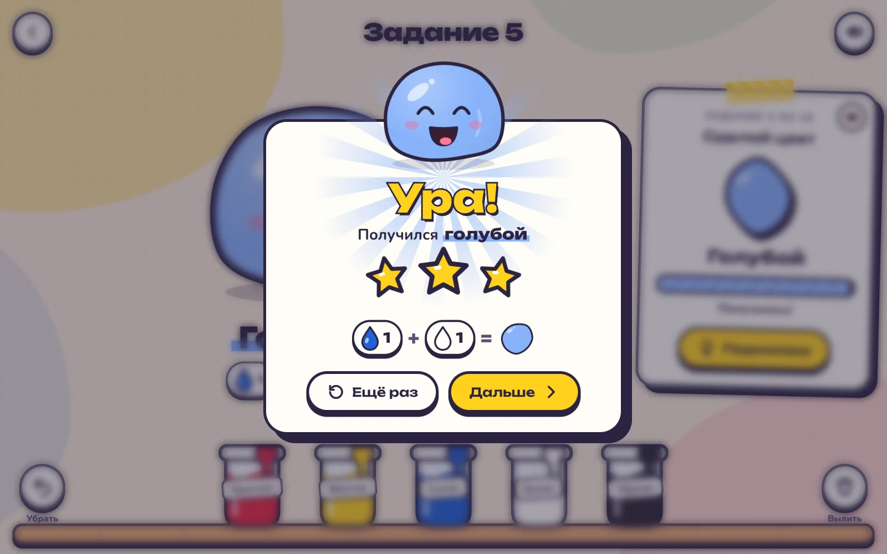
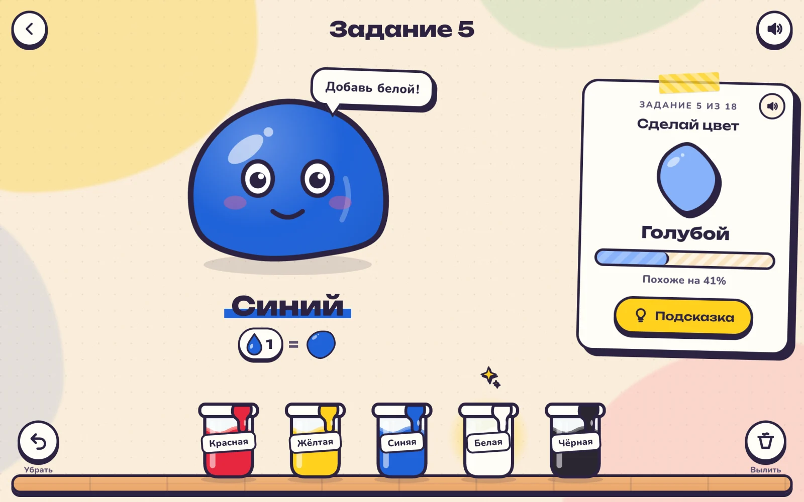
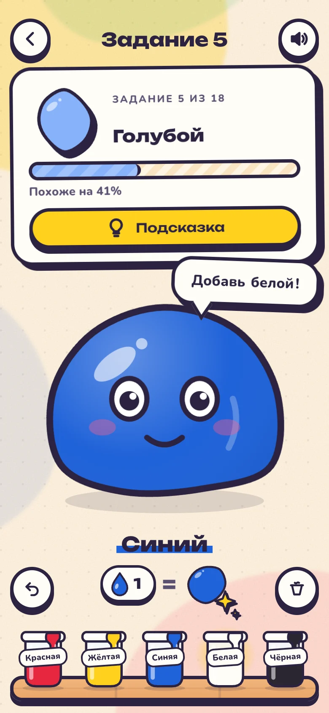

# Клякса — весёлая мастерская цвета

Игра для детей 3–7 лет про смешивание красок. Ребёнок капает краски из баночек
в живую кляксу, а она меняет цвет, называет его вслух и собирает коллекцию.

**▶ Играть онлайн: https://lenstr.github.io/color-mixer-for-kids/**

- **Играть** — 18 заданий от «оранжевого» до «тёмно-зелёного», со звёздами и подсказками.
- **Мастерская** — свободное смешивание; новые цвета попадают в коллекцию.
- **Коллекция** — найденные цвета с рецептами, нажми на любой, чтобы его услышать.



<table>
  <tr>
    <td></td>
    <td></td>
  </tr>
  <tr>
    <td align="center"><sub>Мастерская: капли закручиваются в кляксе, новый цвет попадает в коллекцию</sub></td>
    <td align="center"><sub>Задание выполнено: звёзды и рецепт цвета</sub></td>
  </tr>
</table>

<table>
  <tr>
    <td width="74%"></td>
    <td width="26%"></td>
  </tr>
  <tr>
    <td align="center"><sub>Подсказка подсвечивает нужную баночку и говорит вслух</sub></td>
    <td align="center"><sub>На телефоне</sub></td>
  </tr>
</table>

## Установка как приложение

Игра — PWA, её можно поставить на планшет или телефон, и после первого запуска
она работает без интернета, вместе с озвучкой.

- **Android, Chrome на компьютере:** кнопка «Установить» на главном экране игры
  или «Установить приложение» в меню браузера.
- **iPhone, iPad:** Safari → «Поделиться» → «На экран „Домой“».

Иконки рисует `bun scripts/generate-icons.ts` (нужен `rsvg-convert` из `librsvg`).

## Запуск

```sh
npm install
npm run dev      # http://localhost:5173
npm run build    # статическая сборка в dist/, работает из любой папки
```

На компьютере краски можно капать клавишами `1`–`5`, `Backspace` убирает каплю, `Delete` выливает краску.

## Как устроено смешивание

`src/color.ts`: краски смешиваются по художественному кругу RYB (красный + жёлтый =
оранжевый), а не как RGB-свет. Восемь вершин куба RYB — подобранные цвета гуаши,
промежуточные цвета интерполируются в OKLab. Белая краска осветляет, а красные
оттенки при этом уходят в розовый, а не в лососевый. Чёрная краска затемняет.

## Отрисовка

Клякса рисуется одним фрагментным шейдером WebGL2 (`src/blob/gl-view.ts`): форма,
спираль краски, блики, обводка и лицо — поля расстояний, поэтому края гладкие на
любом экране. Конфетти — один инстансированный вызов отрисовки. Остальные
анимации (фон, волна в баночках, полоски шкалы) двигаются только через
`transform`, их ведёт композитор браузера. Нужен браузер с WebGL2.

## Озвучка

Все фразы лежат в `src/phrases.ts` и заранее озвучены через ElevenLabs в `public/voice/*.mp3`.
Если файла нет, игра говорит системным голосом. Если поменяли или добавили фразы, перегенерируйте их:

```sh
bun scripts/generate-voice.ts --key-file /path/to/elevenlabs.key   # только недостающие
bun scripts/generate-voice.ts --key-file ... --only name-mint      # перезаписать выбранные
```

Ключ нужен только скрипту и в игру не попадает.
