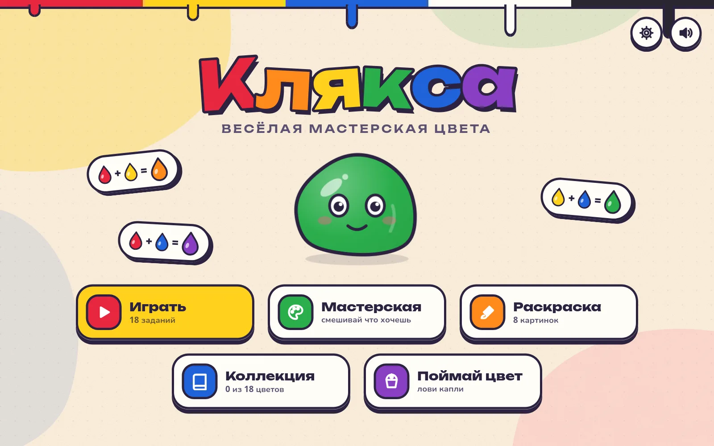
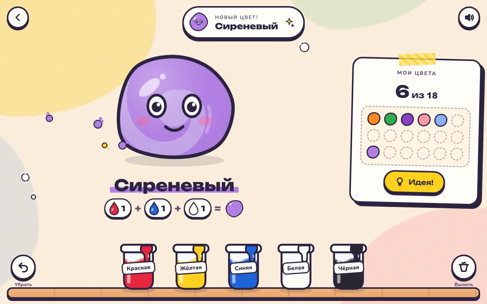
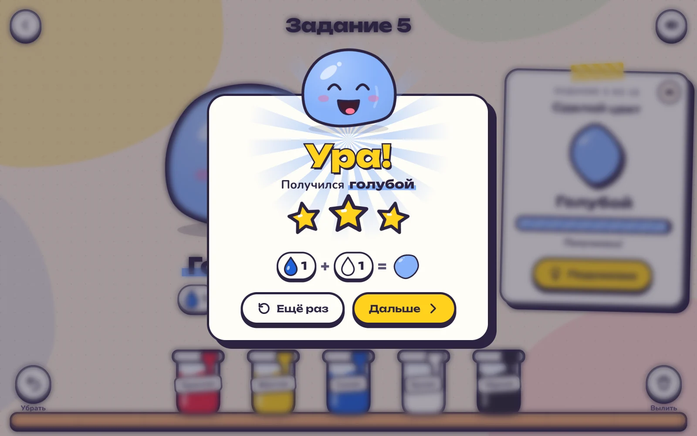
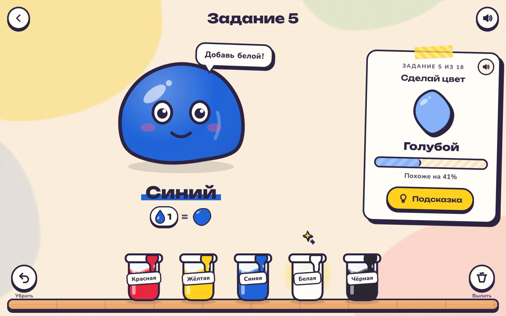
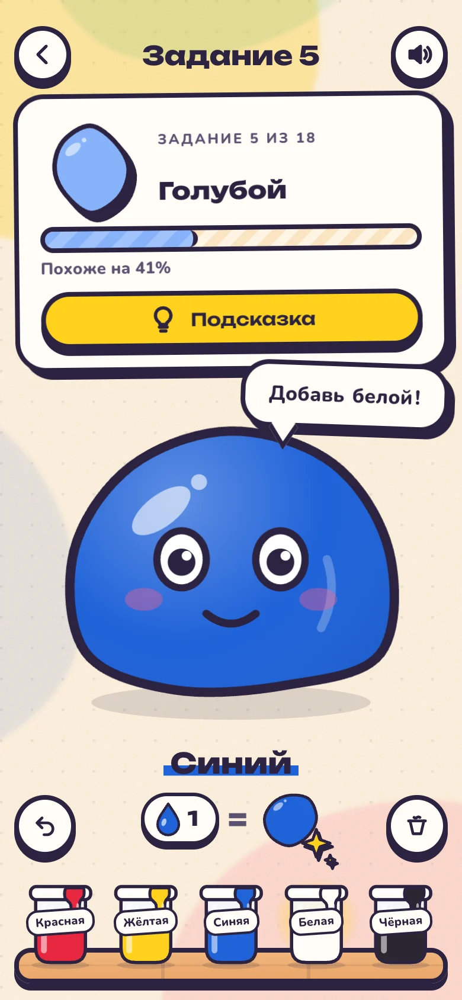
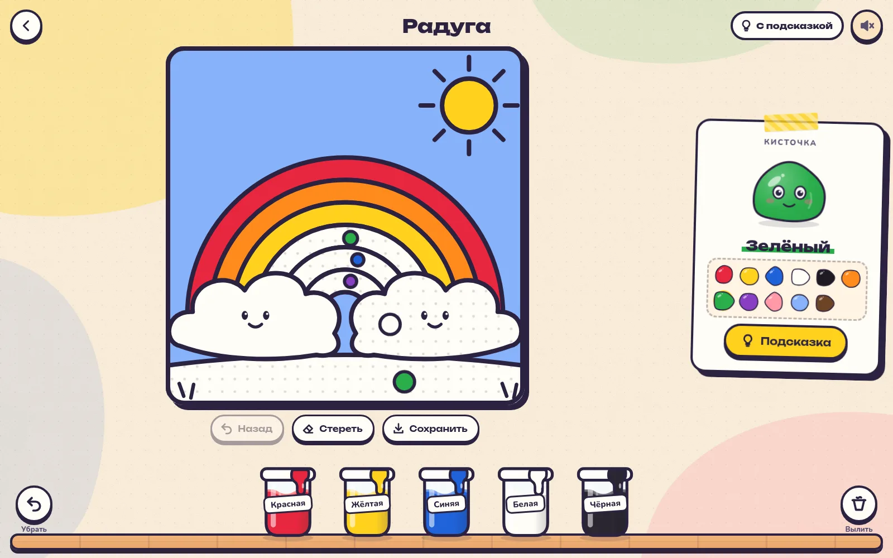
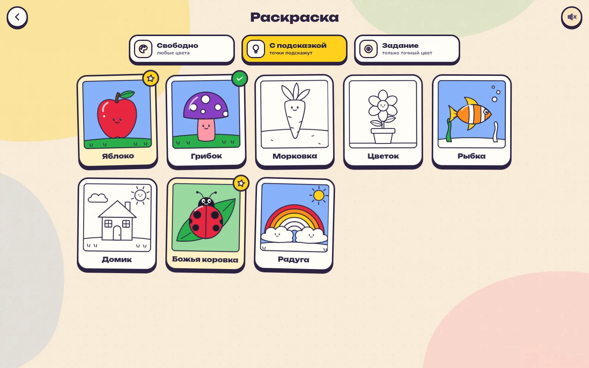
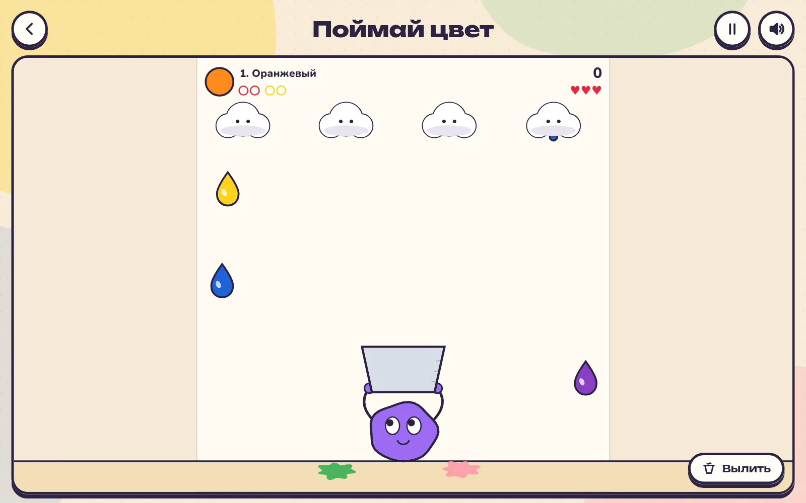

# Клякса — весёлая мастерская цвета

Игра для детей 3–7 лет про смешивание красок. Ребёнок капает краски из баночек
в живую кляксу, а она меняет цвет, называет его вслух и собирает коллекцию.

**▶ Играть онлайн: https://lenstr.github.io/color-mixer-for-kids/**

- **Играть** — 18 заданий от «оранжевого» до «тёмно-зелёного», со звёздами и подсказками.
- **Мастерская** — свободное смешивание; новые цвета попадают в коллекцию.
- **Раскраска** — 8 картинок: смешай краску на кляксе-кисточке и нажми на часть картинки.
- **Коллекция** — найденные цвета с рецептами, нажми на любой, чтобы его услышать.
- **Поймай цвет** — мини-игра на ловкость для детей постарше: лови капли в ведро и смешай
  нужный цвет.
- **Для взрослых** — шестерёнка на главном экране. Сначала нужно решить пример, который
  ребёнку не по силам; потом можно открыть все задания или сбросить прогресс (звёзды,
  коллекцию, раскраски и рекорд).

Задания открываются с запасом: доступны три задания после самого дальнего пройденного,
поэтому ребёнок, который застрял, может попробовать другое.



<table>
  <tr>
    <td></td>
    <td></td>
  </tr>
  <tr>
    <td align="center"><sub>Мастерская: капли закручиваются в кляксе, новый цвет попадает в коллекцию</sub></td>
    <td align="center"><sub>Задание выполнено: звёзды и рецепт цвета</sub></td>
  </tr>
</table>

<table>
  <tr>
    <td width="74%"></td>
    <td width="26%"></td>
  </tr>
  <tr>
    <td align="center"><sub>Подсказка подсвечивает нужную баночку и говорит вслух</sub></td>
    <td align="center"><sub>На телефоне</sub></td>
  </tr>
</table>

## Раскраска

Краску для кисточки можно смешать баночками или взять готовую из «Моих цветов»: там основные
краски и всё, что ребёнок уже нашёл. От пальца краска растекается по выбранной части картинки.
Если на кисточке смешался новый цвет, он тоже попадает в коллекцию.

Перед картинкой выбирается режим:

- **Свободно** — любые цвета, без подсказок.
- **С подсказкой** — в каждой части мигает точка «настоящего» цвета (листик зелёный, небо
  голубое). Красить можно чем угодно, но за точный цвет точка гаснет и сыплются искры.
  Кнопка «Подсказка» показывает, какую краску добавить.
- **Задание** — точек нет: ребёнок сам вспоминает, какого цвета вещи на самом деле. Ложится
  только точный цвет, неверный стекает обратно, и тогда на этой части загорается точка;
  её же показывает «Подсказка».

Начатые и готовые картинки сохраняются, экран выбора служит галереей: на миниатюрах видна
работа ребёнка, а за картинку, где все цвета точные, ставится звезда. Кнопка «Сохранить»
скачивает картинку в PNG, на телефоне открывает «Поделиться».

<table>
  <tr>
    <td></td>
    <td></td>
  </tr>
  <tr>
    <td align="center"><sub>Точки подсказывают цвета, кисточка — живая клякса</sub></td>
    <td align="center"><sub>Режимы и галерея работ</sub></td>
  </tr>
</table>

Картинки нарисованы в `src/coloring/pictures.ts`: каждая часть — SVG-контур с цветом из
коллекции, который считается «настоящим».

## Поймай цвет

Мини-игра для детей от 6 лет. Из белых тучек падают капли девяти цветов: красная, жёлтая,
синяя, белая, зелёная, розовая, голубая, чёрная и фиолетовая, а иногда сердитая грязь. Клякса
носит на голове ведро, ребёнок водит её пальцем или стрелками.

- Сверху показан нужный цвет и его рецепт кружками: ведро вмещает рецепт дважды, для
  оранжевого это две красные и две жёлтые капли. Смешанная капля вливает весь свой рецепт:
  зелёная — это жёлтая и синяя сразу.
- Перед тем как уронить каплю, тучка вздрагивает, и под ней набухает капля своего цвета.
- Лишняя капля или грязь портят ведро и отнимают одно из трёх сердечек. Ведро можно
  вылить самому, без потери сердечка.
- Капли подряд дают серию до ×5, за полное ведро — бонус, и начинается следующий цвет,
  а падает всё быстрее. Цвета идут по порядку заданий.
- Каждые 40 секунд по полке пробегает мышка со шваброй и вытирает все кляксы.
- За каждый собранный цвет Клякса выпивает ведро и становится этого цвета.
- Лучший счёт сохраняется и виден на главном экране.

Небо, капли, ведро и полка рисуются на canvas в `src/catch/game.ts`, Клякса та же живая
WebGL-клякса, что и в мастерской, а карточка задания и окна — общие элементы игры.



## Установка как приложение

Игра — PWA, её можно поставить на планшет или телефон, и после первого запуска
она работает без интернета, вместе с озвучкой.

- **Android, Chrome на компьютере:** кнопка «Установить» на главном экране игры
  или «Установить приложение» в меню браузера.
- **iPhone, iPad:** Safari → «Поделиться» → «На экран „Домой“».

Иконки рисует `bun scripts/generate-icons.ts` (нужен `rsvg-convert` из `librsvg`).

## Запуск

```sh
npm install
npm run dev      # http://localhost:5173
npm run build    # статическая сборка в dist/, работает из любой папки
```

С [mise](https://mise.jdx.dev) dev-сервер работает в фоне как
[демон mise](https://mise.jdx.dev/daemons.html) (экспериментальная функция, её включает
`mise.toml`) и переживает закрытие терминала. mise ставит Node той же версии, что в CI, и
супервизор [pitchfork](https://pitchfork.jdx.dev):

```sh
mise install     # Node и pitchfork из mise.toml
mise run dev     # запустить в фоне; если уже запущен, ничего не делает
mise run logs    # вывод сервера
mise run stop    # остановить
```

Чтобы dev-сервер слушал другой адрес, задайте его в `.env.local` (файл не попадает в git):

```sh
DEV_HOST=192.168.1.10   # или 0.0.0.0 — все интерфейсы
```

На компьютере краски можно капать клавишами `1`–`5`, `Backspace` убирает каплю, `Delete` выливает краску.

## Как устроено смешивание

`src/color.ts`: краски смешиваются по художественному кругу RYB (красный + жёлтый =
оранжевый), а не как RGB-свет. Восемь вершин куба RYB — подобранные цвета гуаши,
промежуточные цвета интерполируются в OKLab. Белая краска осветляет, а красные
оттенки при этом уходят в розовый, а не в лососевый. Чёрная краска затемняет.

## Отрисовка

Клякса рисуется одним фрагментным шейдером WebGL2 (`src/blob/gl-view.ts`): форма,
спираль краски, блики, обводка и лицо — поля расстояний, поэтому края гладкие на
любом экране. Конфетти — один инстансированный вызов отрисовки. Остальные
анимации (фон, волна в баночках, полоски шкалы) двигаются только через
`transform`, их ведёт композитор браузера. Нужен браузер с WebGL2.

## Озвучка

Все фразы лежат в `src/phrases.ts` и заранее озвучены через ElevenLabs в `public/voice/*.mp3`.
Если файла нет, игра говорит системным голосом. Если поменяли или добавили фразы, перегенерируйте их:

```sh
bun scripts/generate-voice.ts --key-file /path/to/elevenlabs.key   # только недостающие
bun scripts/generate-voice.ts --key-file ... --only name-mint      # перезаписать выбранные
```

Ключ нужен только скрипту и в игру не попадает.
